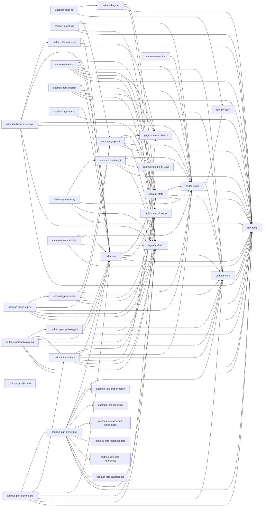

# Cadmus Shell V3

This project was generated using [Angular CLI](https://github.com/angular/angular-cli) version 19.0.6.

This is the third iteration of [Cadmus](https://myrmex.github.io/overview/cadmus) frontend refactoring. This app is used as a shell for developing core UI components and generic part editors. All the libraries in V3 have been bumped to **major version 8**.

1. [original shell app](https://github.com/vedph/cadmus_shell): this was a draft.
2. [version 1](https://github.com/vedph/cadmus-shell): this is obsolete.
3. [version 2](https://github.com/vedph/cadmus-shell-2): this is a production version.
4. version 3 is this version. It has been cloned from V2, with upgrade to [V2 bricks](https://github.com/vedph/cadmus-bricks-shell-v2#migration-from-v1), which affected only a subset of the libraries. Yet, to ensure compatibility I have created a new repository so that existing Cadmus apps can continue to refer to V2 until they upgrade.

🐋 Quick **Docker** image build:

1. `pnpm run build-lib`;
2. update version in `env.js` (and Docker files), and then `ng build --configuration=production`;
3. `docker build . -t vedph2020/cadmus-shell:17.0.0 -t vedph2020/cadmus-shell:latest` (replace with the current version).

## Libraries

Latest versions:

- cadmus-api: 20.0.0
- cadmus-core: 20.0.0
- cadmus-flags-pg: 20.0.0
- cadmus-flags-ui: 20.0.0
- cadmus-graph-pg: 20.0.0
- cadmus-graph-pg-ex: 20.0.0
- cadmus-graph-ui: 20.0.0
- cadmus-graph-ui-ex: 20.0.0
- cadmus-item-editor: 20.0.1
- cadmus-item-list: 20.0.1
- cadmus-item-search: 20.0.0
- cadmus-layer-demo: 20.0.0
- cadmus-part-general-pg: 20.0.0
- cadmus-part-general-ui: 20.0.0
- cadmus-part-philology-pg: 20.0.1
- cadmus-part-philology-ui: 20.0.1
- cadmus-part-taxo-pg: 20.0.0
- cadmus-part-taxo-ui: 20.0.0
- cadmus-preview-pg: 20.0.0
- cadmus-preview-ui: 20.0.0
- cadmus-profile-core: 20.0.0
- cadmus-profile-editor: 20.0.0
- cadmus-profile-import: 20.0.0
- cadmus-state: 20.0.0
- cadmus-statistics: 20.0.0
- cadmus-thesaurus-editor: 20.0.0
- cadmus-thesaurus-list: 20.0.0
- cadmus-thesaurus-ui: 20.0.0
- cadmus-ui: 20.0.1

> cadmus-ui-pg has been removed!

Dependencies:



### Parts

Most of the libraries in this workspace contain infrastructure logic for Cadmus frontend apps, except for those libraries representing data items parts of general usage:

- `@myrmidon/cadmus-part-general-ui`: general purpose part editors.
- `@myrmidon/cadmus-part-general-pg`: wrappers for general purpose part editors.
- `@myrmidon/cadmus-part-philology-ui`: philology-related generic parts.
- `@myrmidon/cadmus-part-philology-pg`: wrappers for philology-related generic parts.

Often, these parts use UI widgets from [Cadmus bricks](https://github.com/vedph/cadmus-bricks-shell-v3).

## Context Help

Part and fragment editors can show a help button (`HelpLinkComponent`), which opens the help page for the edited part or fragment type in a new tab. The page URL is resolved by `EditorHelpService` (`@myrmidon/cadmus-ui`) from the settings in the app's `env.js`. When no page is found, no button is shown.

This lets you:

- inherit help pages from a **general-purpose help site**, shared by all the Cadmus projects, and write project-specific pages only for the parts which are specific to your project, or which need a different help in it;
- provide **localized help sites**, falling back to the default (usually English) help for the pages which are not translated.

### Settings

```js
// URL template(s) for help pages, in their search order (required: no help without it)
window.__env.helpUrlTemplate = [
  "https://myproject.github.io/help[-{language}]/topics/{typeId}{separator}{roleId}{separator}{frRoleId}.html",
  "https://cadmus.github.io/help[-{language}]/topics/{typeId}{separator}{roleId}{separator}{frRoleId}.html",
];
// value of {language} (optional): a language code like "it", or "auto" for the browser language
window.__env.helpUrlLanguage = "auto";
// value of {separator} (optional, default: __)
window.__env.helpUrlSeparator = "__";
// false to skip checking page availability (optional, default: true)
window.__env.helpUrlCheck = true;
```

- `helpUrlTemplate`: a template, or an array of templates in their search order. A string with several templates separated by spaces or newlines is accepted too, which is handy when `env.js` is generated from environment variables (e.g. in Docker): URLs cannot contain spaces.
- `helpUrlLanguage`: a language code (typically BCP47, e.g. `it` or `pt-BR`), or `auto` to use the browser language (`navigator.language`). When not set, `{language}` is always empty, i.e. only the default help is used. Invalid codes are ignored.
- `helpUrlSeparator`: the value of `{separator}` (default `__`).
- `helpUrlCheck`: set to `false` to skip the availability check (see below).

### Templates

A template can include these **placeholders**. Their values are URL-encoded; an empty value is replaced by nothing:

| placeholder   | part editor        | fragment editor                               |
| ------------- | ------------------ | --------------------------------------------- |
| `{typeId}`    | part type ID       | fragment type ID (e.g. `fr.it.vedph.comment`) |
| `{roleId}`    | part role ID       | always empty                                  |
| `{frRoleId}`  | always empty       | fragment role ID                              |
| `{language}`  | help language code | help language code                            |
| `{separator}` | the separator      | the separator                                 |

**Optional groups** in square brackets are output (without brackets) only when all the placeholders inside them have a value; otherwise, the whole group is dropped. `{separator}` immediately followed by a placeholder is a shortcut for such a group, so `{separator}{roleId}` is the same as `[{separator}{roleId}]`. Groups cannot be nested.

⚠️ Always put `{language}` in an optional group, together with its delimiter, so that the default (non-localized) URL is well-formed: e.g. `help[-{language}]/` gives `help-it/` or `help/`; `help/[{language}/]` gives `help/it/` or `help/`. A bare `help-{language}/` would give `help-/` for the default help.

### Search Order

When `helpUrlCheck` is not false, the service builds a list of candidate URLs and uses the first available page. The rule is: **the most relevant content wins; language is preferred only among equally relevant pages**. So candidates are built like this:

1. for each **template**, in their order (so a page found in the project site always wins over the general-purpose site: this is how a project overrides a default page);
2. for each **topic**, from the most specific to the least specific: first with all the IDs, then without `{frRoleId}`, then without `{roleId}` (so a page for the type ID is used for all its roles, unless a role-specific page exists);
3. for each **language**, from the most specific to the least specific (e.g. `it-it`, then `it`), and finally with no language (the default help).

Duplicate URLs are removed: e.g. when a template has no `{language}`, or there is no role ID, fewer candidates are tried.

**Language codes** are normalized to lowercase, with `_` replaced by `-`; when the code has more subtags (e.g. `it-IT` or `zh-Hant-TW`), they are removed one by one from the end, as in the BCP47 lookup algorithm (`zh-hant-tw`, `zh-hant`, `zh`). So with `auto`, a browser set to `it-IT` tries `it-it` and then `it`: name localized sites with the lowercase primary language code (e.g. `help-it`), unless you need regional variants.

Checks use `fetch` (so no credentials are sent), and their results are cached for the session, so each URL is requested at most once. When no page is found, the URLs tried are logged in the browser console (as info), so you can see which topics are missing. The help sites must allow cross-origin requests (CORS); GitHub Pages does.

If a help site does not allow CORS, set `helpUrlCheck` to false: then no check is made, and the first candidate (first template, most specific topic, most specific language) is always used, even if it does not exist. As fallbacks require checks, in this case use a single template with no `{language}`.

### Scenarios

In all these examples the separator is the default (`__`), and `.../` stands for the template's path to topics.

**1. Single help site**:

```js
window.__env.helpUrlTemplate =
  "https://myproject.github.io/help/topics/{typeId}{separator}{roleId}{separator}{frRoleId}.html";
```

| editor                             | URLs tried, in order                                                                                 |
| ---------------------------------- | ---------------------------------------------------------------------------------------------------- |
| note part, no role                 | `.../topics/it.vedph.note.html`                                                                      |
| note part, role `history`          | `.../topics/it.vedph.note__history.html`, `.../topics/it.vedph.note.html`                            |
| comment fragment, fr. role `sch`   | `.../topics/fr.it.vedph.comment__sch.html`, `.../topics/fr.it.vedph.comment.html`                    |

**2. Project site with fallback to a general-purpose site**:

```js
window.__env.helpUrlTemplate = [
  "https://myproject.github.io/help/topics/{typeId}{separator}{roleId}.html",
  "https://cadmus.github.io/help/topics/{typeId}{separator}{roleId}.html",
];
```

For the note part with role `history`:

1. `https://myproject.github.io/help/topics/it.vedph.note__history.html`
2. `https://myproject.github.io/help/topics/it.vedph.note.html`
3. `https://cadmus.github.io/help/topics/it.vedph.note__history.html`
4. `https://cadmus.github.io/help/topics/it.vedph.note.html`

So the project site contains only the pages for its own parts, and for the general parts it wants to document differently: for all the others, the general-purpose site is used. Note that a project page for a type (2) overrides also the role-specific pages of the general-purpose site for that type (3): once a project documents a type, it owns all of its help.

**3. Localized help**:

```js
window.__env.helpUrlTemplate =
  "https://cadmus.github.io/help[-{language}]/topics/{typeId}{separator}{roleId}.html";
window.__env.helpUrlLanguage = "it";
```

For the note part with role `history`:

1. `https://cadmus.github.io/help-it/topics/it.vedph.note__history.html`
2. `https://cadmus.github.io/help/topics/it.vedph.note__history.html`
3. `https://cadmus.github.io/help-it/topics/it.vedph.note.html`
4. `https://cadmus.github.io/help/topics/it.vedph.note.html`

When `helpUrlLanguage` is not set, only (2) and (4) are tried. Note that an English role-specific page (2) wins over an Italian generic page (3), because it is more relevant: so when translating, translate role-specific pages together with their generic page.

**4. Both** (as in the [settings](#settings) above, with `auto` and a browser set to `it-IT`), for the note part with no role:

1. `https://myproject.github.io/help-it-it/topics/it.vedph.note.html`
2. `https://myproject.github.io/help-it/topics/it.vedph.note.html`
3. `https://myproject.github.io/help/topics/it.vedph.note.html`
4. `https://cadmus.github.io/help-it-it/topics/it.vedph.note.html`
5. `https://cadmus.github.io/help-it/topics/it.vedph.note.html`
6. `https://cadmus.github.io/help/topics/it.vedph.note.html`

**Other template styles**:

- one page per type, with a bookmark per role: `https://www.mysite.com/help/{typeId}.html[#{roleId}][#{frRoleId}]`. Bookmarks do not affect the availability check, so the check is done on the type page only.
- query string: `https://www.mysite.com/help?type={typeId}[&role={roleId}][&frRole={frRoleId}][&lang={language}]`.
- language as a path segment: `https://www.mysite.com/help/[{language}/]{typeId}.html`.
- Jekyll with pretty permalinks: `https://www.mysite.com/help/{typeId}[-{roleId}][-{frRoleId}]/`.

### Writing Help Sites with Jekyll

Help sites are usually GitHub repositories published as GitHub Pages with Jekyll, where each Markdown file becomes an HTML page with the same name. A repository named `help` in the GitHub account `cadmus` is published at `https://cadmus.github.io/help/`.

- **topics**: with the templates above, create a Markdown file for each part/fragment type, named after its type ID (e.g. `topics/it.vedph.note.md`, `topics/fr.it.vedph.comment.md`). For role-specific help, add a file named after type ID, separator and role ID (e.g. `topics/it.vedph.note__history.md`, `topics/fr.it.vedph.comment__sch.md`). Avoid characters in role IDs which are not valid in file names; when needed, pick a different separator or template.
- **general-purpose site**: document there the parts and fragments of the shared libraries (e.g. `@myrmidon/cadmus-part-general-ui`). Every project using them gets their help for free by adding this site as its last template.
- **project site**: document there only the project-specific parts, and the general ones which need a different help in the project. List its template first.
- **localized site**: copy the files of a site into a new repository, named like the original one plus the language code (e.g. `help-it`), translate them, and publish it. You can translate only some pages: for the others, the default site is used.

To get the help language from somewhere else than `env.js` and the browser (e.g. from a language setting of your app), derive a service from `EditorHelpService`, override its `getLanguages()` method (which returns the language codes to try, from the most specific to the least specific), and provide it in place of `EditorHelpService`.

## Workspace Setup

This workspace was created with these commands:

```sh
ng new cadmus-shell-v3
cd cadmus-shell-v3
ng add @angular/material
ng add @angular/localize

ng g library @myrmidon/cadmus-api --prefix cadmus --force
ng g library @myrmidon/cadmus-core --prefix cadmus --force
ng g library @myrmidon/cadmus-flags-pg --prefix cadmus --force
ng g library @myrmidon/cadmus-flags-ui --prefix cadmus --force
ng g library @myrmidon/cadmus-graph-pg --prefix cadmus --force
ng g library @myrmidon/cadmus-graph-pg-ex --prefix cadmus --force
ng g library @myrmidon/cadmus-graph-ui --prefix cadmus --force
ng g library @myrmidon/cadmus-graph-ui-ex --prefix cadmus --force
ng g library @myrmidon/cadmus-item-editor --prefix cadmus --force
ng g library @myrmidon/cadmus-item-list --prefix cadmus --force
ng g library @myrmidon/cadmus-item-search --prefix cadmus --force
ng g library @myrmidon/cadmus-layer-demo --prefix cadmus --force
ng g library @myrmidon/cadmus-part-general-pg --prefix cadmus --force
ng g library @myrmidon/cadmus-part-general-ui --prefix cadmus --force
ng g library @myrmidon/cadmus-part-philology-pg --prefix cadmus --force
ng g library @myrmidon/cadmus-part-philology-ui --prefix cadmus --force
ng g library @myrmidon/cadmus-part-taxo-ui --prefix cadmus --force
ng g library @myrmidon/cadmus-part-taxo-pg --prefix cadmus --force
ng g library @myrmidon/cadmus-preview-pg --prefix cadmus --force
ng g library @myrmidon/cadmus-preview-ui --prefix cadmus --force
ng g library @myrmidon/cadmus-profile-core --prefix cadmus --force
ng g library @myrmidon/cadmus-state --prefix cadmus --force
ng g library @myrmidon/cadmus-statistics --prefix cadmus --force
ng g library @myrmidon/cadmus-thesaurus-editor --prefix cadmus --force
ng g library @myrmidon/cadmus-thesaurus-list --prefix cadmus --force
ng g library @myrmidon/cadmus-thesaurus-ui --prefix cadmus --force
ng g library @myrmidon/cadmus-ui --prefix cadmus --force
```

>⚠️ Unlike the other workspace libraries, `@myrmidon/cadmus-api` is listed in the root `package.json` as `link:./dist/myrmidon/cadmus-api`. This is because some external npm packages (`@myrmidon/cadmus-refs-asserted-ids`, `@myrmidon/cadmus-text-ed-md`) declare it as a peer dependency, which pnpm must satisfy. Linking to the local build ensures that these packages use the same `cadmus-api` code as the workspace (via `tsconfig` `paths`), rather than a separate copy from npm. As a consequence, build `cadmus-api` (`pnpm run build:api`) before running `pnpm install`, or the link will point to a missing folder.

## History

- ⌛ [history](CHANGELOG.md)
