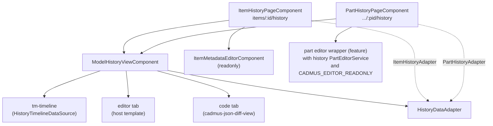

# CadmusUiHistory

Edit history view for Cadmus items and parts: browse the saved versions of an item or part on a timeline, view each version in its (read-only) editor, compare it with the current version, download it, and restore it.

- 📦 `@myrmidon/cadmus-ui-history`
- requires a Cadmus API with the history endpoints (Cadmus backend 18.1.0+).

- [CadmusUiHistory](#cadmusuihistory)
  - [How History Works](#how-history-works)
  - [Setup](#setup)
  - [Architecture](#architecture)
    - [ModelHistoryViewComponent](#modelhistoryviewcomponent)
    - [HistoryDataAdapter](#historydataadapter)
    - [Item History](#item-history)
    - [Part History](#part-history)
    - [Read-only Editors](#read-only-editors)
  - [Restoring](#restoring)
  - [Limitations](#limitations)

## How History Works

Each time an item or part is saved, the backend stores the saved state in history (`HistoryItem`, `HistoryPart`), together with the user who saved it, the save time and an edit status (created, updated, deleted). Each history record has its own ID, and a reference ID equal to the ID of the item or part it refers to. So:

- the history of an item or part is the list of all its saved states, sorted by time;
- the newest history record is the current state of the item or part;
- restoring a version just means saving it again: this is historized like any other save, so a restore can be undone by restoring the previous version.

Note that some operations do not affect history: setting the flags or the group ID of items in batch (from the items list), setting the thesaurus scope of parts, and saves with history disabled (e.g. imports). So, the current version may differ from the newest history record, and an item or part may have no history at all.

The history of an item refers only to its metadata (title, description, facet, group, sort key, flags). Each part has its own history.

## Setup

(1) in your app routes, add the item history route, and wrap the routes of each parts library with `withHistoryRoutes`. Load the history library lazily, with the parts libraries, so that it is not included in the main bundle:

```ts
// item history: this must be the item editor route with /history
{
  path: 'items/:id/history',
  loadComponent: () =>
    import('@myrmidon/cadmus-ui-history').then(
      (module) => module.ItemHistoryPageComponent,
    ),
  canActivate: [jwtGuard],
},
// ... for each parts library:
{
  path: 'items/:iid/general',
  loadChildren: () =>
    Promise.all([
      import('@myrmidon/cadmus-part-general-pg'),
      import('@myrmidon/cadmus-ui-history'),
    ]).then(([module, history]) =>
      history.withHistoryRoutes(module.CADMUS_PART_GENERAL_PG_ROUTES),
    ),
  canActivate: [jwtGuard],
},
```

`withHistoryRoutes` adds to each part editor route (`<type-id>/:pid`) a history route (`<type-id>/:pid/history`). No change is required in the parts libraries.

(2) in your `env.js`, enable the history buttons in the items list and in the item editor (they are hidden by default, so that apps which did not add the routes are not affected):

```js
window.__env.historyEnabled = true;
```

Then:

- in the items list, the history button of each item opens `items/<id>/history`;
- in the item editor, the history button of each part (in the parts and layers lists) opens the part editor route with a final `/history`, like `items/<iid>/general/it.vedph.note/<pid>/history?rid=<role>`.

## Architecture



### ModelHistoryViewComponent

`cadmus-model-history-view` is the generic history view. It knows nothing about items or parts: its data come from an adapter (`adapter` input), and the editor of the selected version is rendered from a template provided by the host (`editorTemplate` input). Its layout has three vertically stacked sections:

1. **timeline** (`@myrmidon/timeline-view`): the versions are loaded on demand while zooming and scrolling (virtual data), starting from the last week (or from the week before the newest version, when this is older). Point values are times (milliseconds since the epoch), and the custom range accepts ISO-like local dates and times (`IsoDateTimeTimelineParser`: `YYYY`, `YYYY-MM`, `YYYY-MM-DD`, `YYYY-MM-DD HH:mm[:ss]`). Each point is labeled with the save date, time and user. Preset ranges: last day, week, month, year, and custom. Selection is single: the newest version is selected at start.
2. **selected version**, in two tabs:
   - **editor**: the host template, with the selected `HistoryEntry` as its context (`let-entry`). The host is responsible for making its editor read-only.
   - **code** (only when a current version exists): the JSON diff (`@myrmidon/cadmus-ui-diff`) between the selected version (left) and the current one (right).
3. **toolbar**: download the selected version as a pretty-printed JSON file; restore it (when `canRestore` is true, after confirmation); select the newest version; and the metadata of the version (status, user and time of save, creator and time of creation).

Inputs:

- `adapter` (required): the `HistoryDataAdapter`.
- `editorTemplate`: the editor template. When not set, there is no editor tab.
- `canRestore`: true when the user can restore versions.
- `label`: the accessible label of the timeline.

Outputs:

- `restored`: emitted with the restored entry after a restore.

The component is styled with Angular Material M3 system tokens (`--mat-sys-*`), including the timeline CSS variables, so it follows the app theme in both light and dark mode; its toolbar adapts to narrow containers.

### HistoryDataAdapter

The adapter decouples the view from where data come from, and from how a version is restored:

- `getEntries(min, max)`: the history entries saved in a time range. The provided adapters load all the pages of the range from the API.
- `getLatestEntry()`: the newest entry, or null.
- `getEntryData(info)`: the object of an entry.
- `getCurrent()`: the current object, or null if it does not exist.
- `getCreationTime(current)`, `getModifiedTime(current)`: used for the timeline range.
- `toJsonObject(data)`: the object as represented in JSON for display, comparison and download.
- `restore(data, current)`: save the version as the current object.

The provided adapters are `ItemHistoryAdapter` and `PartHistoryAdapter`, using `HistoryService` (`@myrmidon/cadmus-api`). As the view also works with no current version, the same component can be reused for deleted objects (e.g. a future trash bin), with an adapter restoring them as new objects.

### Item History

`ItemHistoryPageComponent` (`items/:id/history`) displays each version in the item metadata editor (`ItemMetadataEditorComponent` from `@myrmidon/cadmus-item-editor`) with `readonly` set. This is the same "dumb" editor used by the item editor page.

### Part History

Part editor routes are defined by each parts library, and only the part editor wrapper (feature) of each part type knows which editor it uses and which thesauri it needs. So, rather than requiring a history route and template for each part type, `withHistoryRoutes` adds for each part editor route a history route to `PartHistoryPageComponent`, passing it the wrapper component in the route data (`HISTORY_FEATURE_KEY`, or `HISTORY_FEATURE_LOADER_KEY` for routes with `loadComponent`).

The page then instantiates the **existing wrapper**, unchanged, for each selected version (`NgComponentOutlet`), with a child injector which provides:

- a `PartEditorService` created by `createHistoryPartEditorService`: it loads the selected version (instead of the part with the routed ID), with the thesauri requested by the wrapper and the thesaurus scope of the version; and it always refuses to save;
- `CADMUS_EDITOR_READONLY` set to true, forcing the wrapped editor into read-only mode.

This works for all the wrappers derived from `EditPartFeatureBase`, which load their data with `PartEditorService.load`. Other wrappers, and layer parts (whose wrapper is a portal to the fragments rather than an editor), have no editor tab: their versions can be inspected in the code view, downloaded and restored.

### Read-only Editors

Read-only mode is enforced at several levels, so that nothing can be saved from history:

- `ModelEditorComponentBase` (`@myrmidon/cadmus-ui`) has a `readonly` input, and is forced read-only when the `CADMUS_EDITOR_READONLY` token is provided with true (`isReadonly()`). In read-only mode its root form is disabled (so all the fields bound to it are disabled), and `save()` does nothing.
- `CloseSaveButtonsComponent` hides its save button when the token is provided, so no editor template needs changes.
- the history `PartEditorService` refuses to save.

Some controls of an editor may still look enabled in read-only mode, e.g. buttons not bound to the form, or child editors with their own forms; but whatever users do there cannot be saved. Editors can use `isReadonly()` to also hide such controls.

## Restoring

Restoring is like a user editing the current version so that it equals the selected one, and saving it. It requires at least the operator role; before asking for confirmation, the view reloads the current version, and warns if someone else changed it since the page was opened.

- **items**: the title, description, facet, group and flags of the version are saved over the current item; the sort key is recomputed by the server. As in the item editor, non-admin users cannot change admin flags: these keep their current value.
- **parts**: the version is saved as the part, keeping the current thesaurus scope, which is not stored in history.

## Limitations

- deleted items and parts are not handled here (they have no history route); the view and the adapters are designed to be reused for them.
- fragments have no history of their own, as they are stored in their layer part: to recover a fragment, inspect its layer part versions in the code view, and copy the data from there.
